<p align="center">
  
</p>

<h1 align="center">DiskTrim</h1>

<p align="center">
  Find what fills your disk and free space <b>safely</b> — a Windows app and a command-line tool in one <code>DiskTrim.exe</code>.<br>
  Version 1.0 · Windows 10/11 · .NET 10
</p>

---

Every folder and file DiskTrim shows is marked with what deleting it would do:

| Badge | Meaning |
|---|---|
| **Safe to delete** | Cache or temporary data; Windows or the app rebuilds it automatically. |
| **Safe, with side effect** | Your data is safe, but something changes (e.g. sign in to Teams again, a slower first build). |
| **Your decision** | Personal or unknown files — only you can decide. |
| **Do not delete** | Needed by Windows or installed programs. DiskTrim refuses to touch these. |

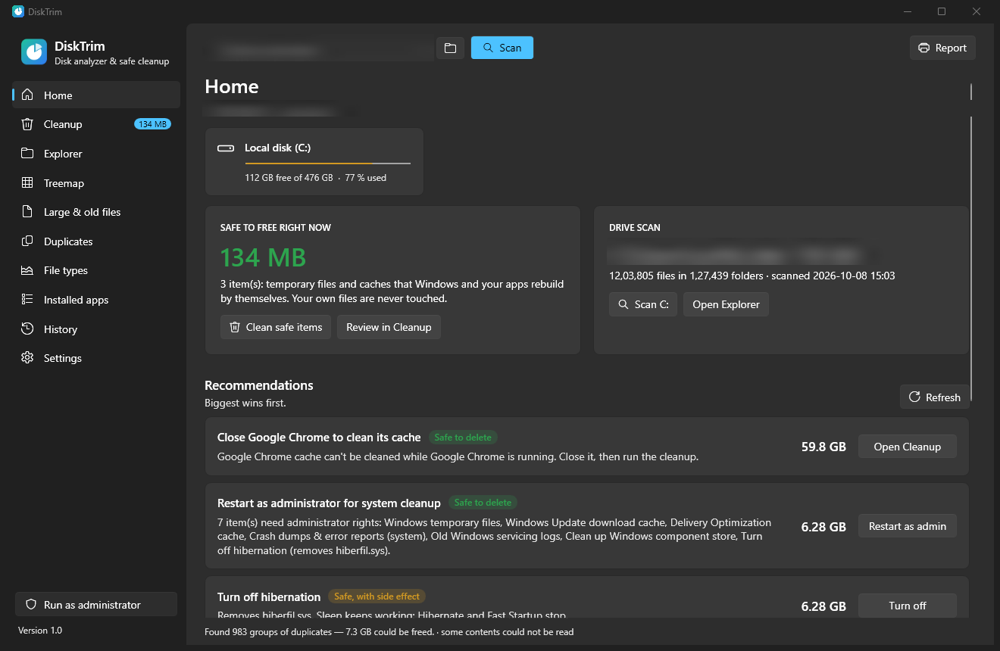

## Features

| Page | What it does |
|---|---|
| **Home** | Drive usage, how much is safe to free right now, and recommendations — biggest wins first. |
| **Cleanup** | Measures temporary files and caches (Windows, browsers, Teams, VS Code, npm/pip/NuGet …) and cleans the ones you tick. |
| **Explorer** | All folders and files by size, each with a safety badge and an explanation. **Search** the scan by name or wildcard (`*.iso`). |
| **Treemap** | The whole scan as a picture: area = size, colour = safety. Double-click to zoom in. |
| **Large & old files** | The biggest files, filtered by size, age and type. **Move them to another drive** with a verified copy. |
| **Duplicates** | Identical files (same content, any name), verified with SHA-256. One copy is always kept. |
| **File types** | Space used per category (videos, photos, installers …) and per extension. |
| **Installed apps** | Programs by size; starts the program's own uninstaller. |
| **History** | Every finished scan is remembered — see which folders grew between two scans. |
| **Settings** | Theme, excluded folders, scheduled cleanup, right-click menu, deletion logs. |

### Cleanup
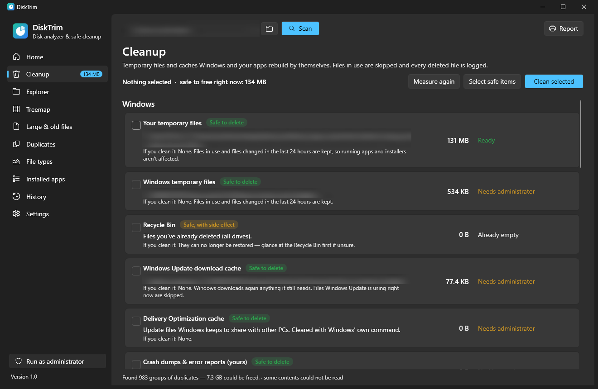

### Explorer
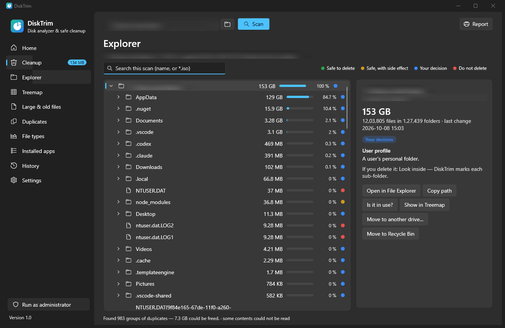

### Search
Type a name (or a wildcard such as `*.iso`) to find it anywhere in the scan; double-click a result to jump to it in the tree.

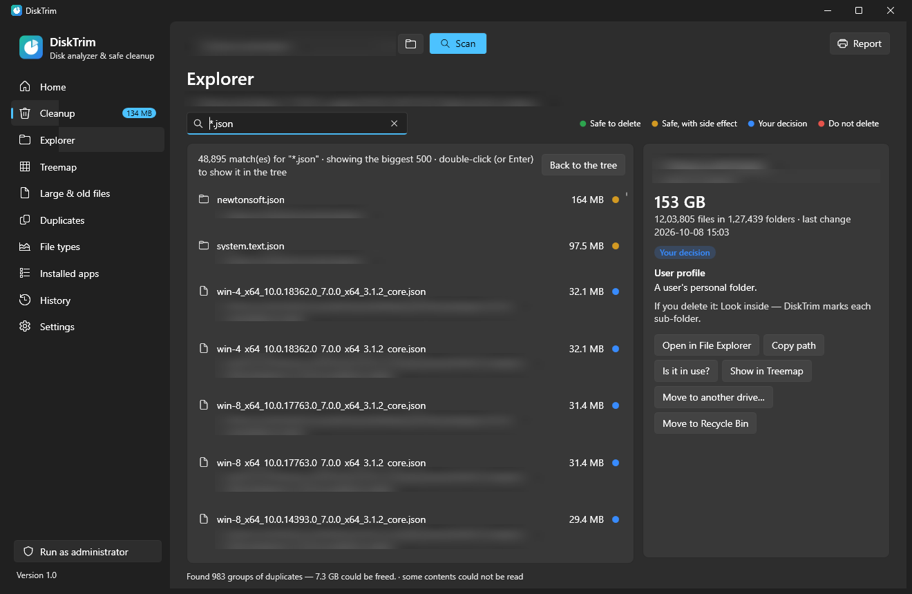

### Treemap
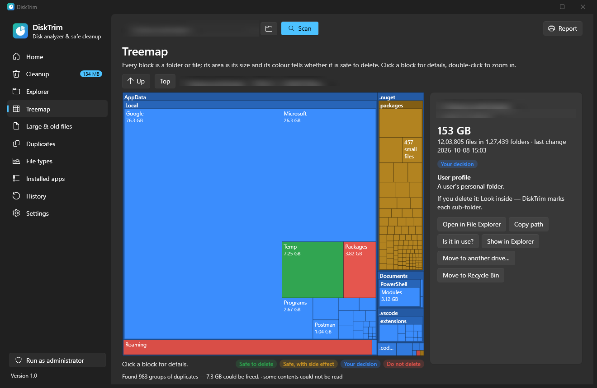

### Large & old files
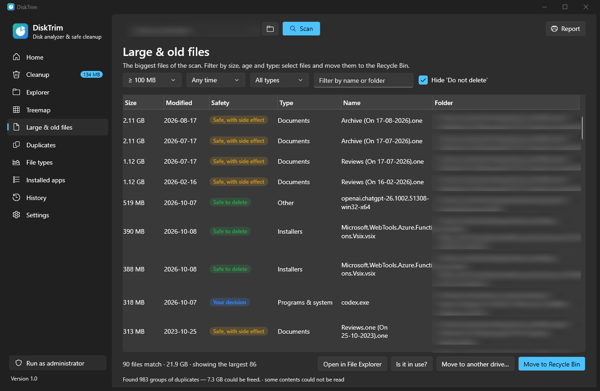

### Duplicates
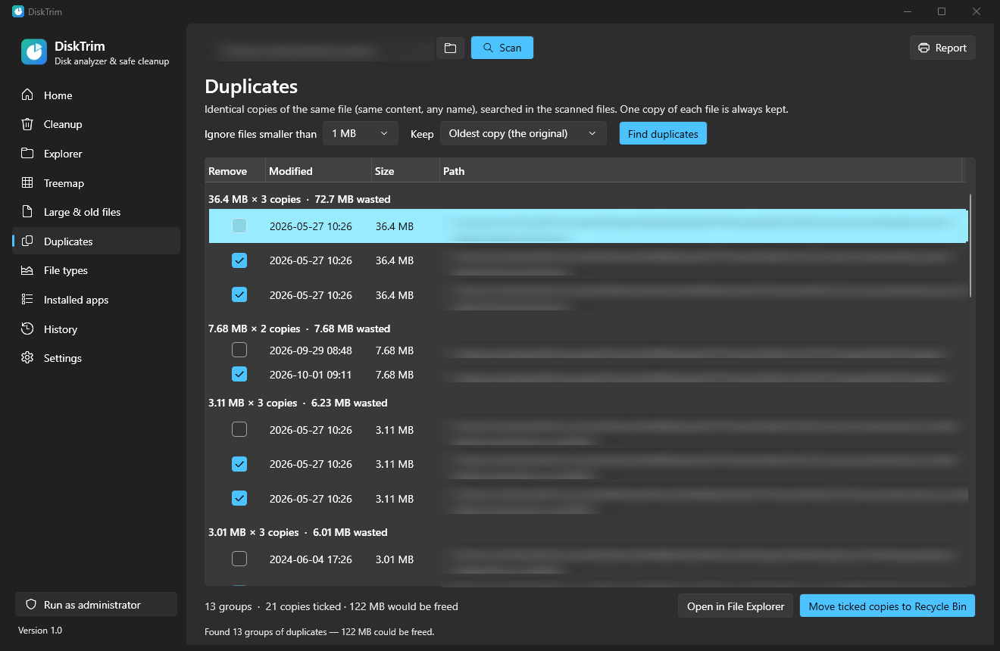

### File types
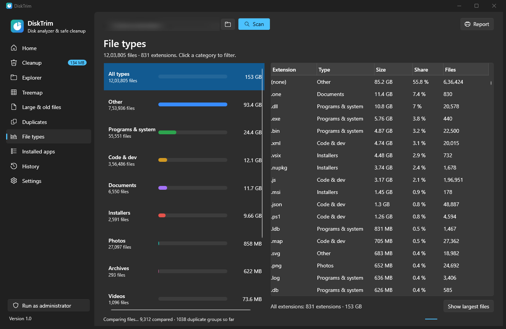

### Installed apps
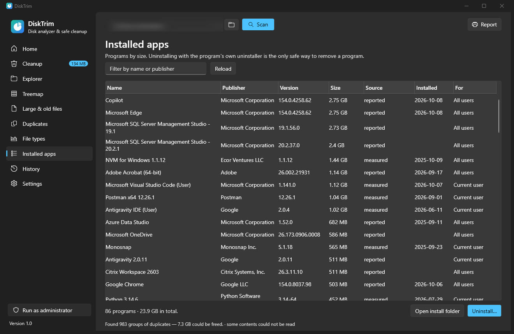

### History
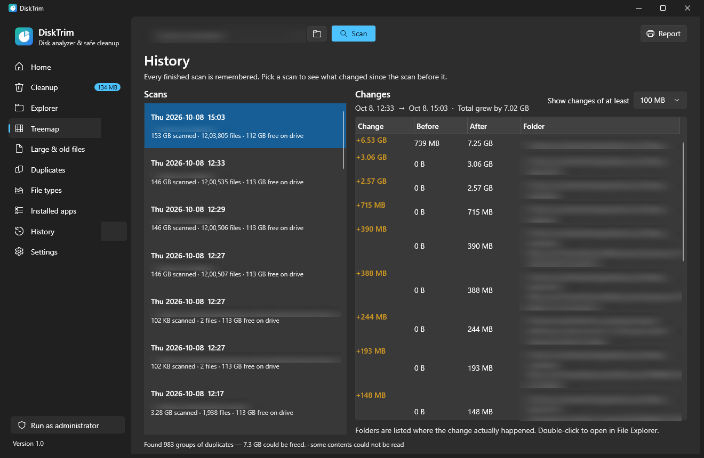

### Settings
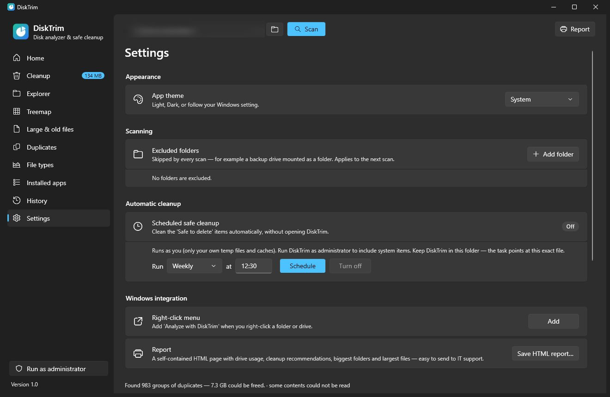

## Install

Download **`DiskTrim-Setup-1.0.exe`** (from the releases page, or build it with `installer\Build-Package.ps1`) and double-click it. No administrator rights and no .NET installation are needed.

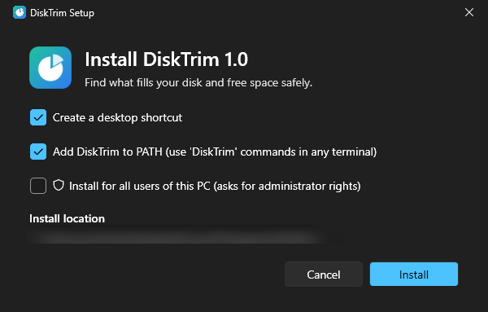

For scripted roll-outs (e.g. Intune):

```powershell
DiskTrim-Setup-1.0.exe --install --silent [--all-users] [--no-desktop-shortcut] [--no-path]
```

The zip `DiskTrim-1.0-win-x64.zip` contains the same exe plus a PowerShell installer (`Install.cmd`) for places where you prefer scripts.

The installer:

- copies `DiskTrim.exe` to `%LocalAppData%\Programs\DiskTrim`
- adds Start menu and desktop shortcuts
- registers DiskTrim in **Settings › Apps**, where it can be uninstalled like any other app
- adds DiskTrim to `PATH`, so `DiskTrim help` works in a new terminal

Run a newer setup to upgrade in place. Options of the PowerShell installer (`Install.cmd` / `Install-DiskTrim.ps1`):

| Option | Effect |
|---|---|
| `-AllUsers` | Install for every user into `Program Files` (asks for administrator rights) |
| `-NoDesktopShortcut` | Skip the desktop shortcut |
| `-NoPath` | Don't add DiskTrim to `PATH` |
| `-Silent -NoLaunch` | No questions and no window — for scripted roll-outs (e.g. Intune) |

**Uninstall:** Settings › Apps › DiskTrim › Uninstall (or `DiskTrim --uninstall [--silent] [--remove-data]`). This also removes the scheduled cleanup and the right-click menu if they were turned on. Your scan history and logs are kept unless you choose to delete them (`-RemoveData`).

> DiskTrim isn't code-signed yet, so Windows SmartScreen may say *"Windows protected your PC"* the first time. Click **More info › Run anyway**.

## Safety

- Nothing is deleted without a confirmation that lists what happens (except the scheduled `--clean-safe` run, which only cleans *Safe to delete* items).
- Files that are in use are skipped. Temporary files changed in the last 24 hours are kept.
- Junctions and symbolic links are shown but **never followed** — cleaning can't reach through a link into other folders.
- Files you pick yourself go to the **Recycle Bin**, never deleted permanently. Locations marked *Do not delete* are refused.
- **Move to another drive** copies each file, verifies the copy byte-for-byte with SHA-256 and only then removes the original. If anything fails, the original is kept; an existing file at the destination is never overwritten.
- Before moving anything, DiskTrim checks whether a running program uses it (Windows Restart Manager).
- Every deleted or moved file is written to a CSV log (Settings › Deletion logs).
- Programs are only removed through their own uninstaller.

## Command line

The same `DiskTrim.exe` works in a terminal. Without arguments it opens the window.

```text
DiskTrim home                                   Drives and recommendations
DiskTrim scan [path] [--depth 2] [--top 20]     Biggest folders and files
DiskTrim files [path] [--min-size 100MB] [--older-than 1y] [--type Videos]
DiskTrim types [path]                           Space by file type
DiskTrim duplicates [path] [--min-size 1MB] [--keep oldest|newest|shortest] [--recycle]
DiskTrim cleanup [--run safe|1,4,edge] [--yes]  Measure / clean temp files and caches
DiskTrim apps [filter] [--uninstall name]       Installed programs by size
DiskTrim history [path] [--compare]             What grew between the last two scans
DiskTrim report [path] [--out file.html]        Save an HTML report
DiskTrim search <name|*.ext> [path]             Find files and folders in the scan by name
DiskTrim move <path> [more…] --to <folder>      Move to another drive (copy, verify, then remove)
DiskTrim inuse <path>                           Which programs use a file or folder
DiskTrim settings exclude|schedule|shell|logs   Settings
DiskTrim menu                                   Interactive menu in the console
DiskTrim --path <folder>                        Open the window on a folder
```

`path` defaults to the system drive. Ctrl+C stops a scan and keeps the results so far. Run `DiskTrim help` for every option.

Exit codes: `0` success · `1` nothing was done · `2` invalid arguments or folder not found.

## Build

Requires the [.NET 10 SDK](https://dotnet.microsoft.com/download) on Windows.

```powershell
dotnet build -c Release                     # bin\Release\net10.0-windows\DiskTrim.exe
dotnet test                                 # unit tests

# single self-contained exe (no .NET install needed on the target PC)
dotnet publish DiskTrim.csproj -c Release -r win-x64 --self-contained -p:PublishSingleFile=true -o dist
```

## Releases

Releases are built by GitHub Actions:

- **CI** (`.github/workflows/ci.yml`) builds and runs all tests on every push and pull request.
- **Release** (`.github/workflows/release.yml`) runs when a version tag is pushed. It tests, publishes a self-contained single-file `DiskTrim.exe` (no .NET needed on the target PC), smoke-tests it, and attaches `DiskTrim-<version>-win-x64.zip` plus a SHA-256 checksum to a GitHub release.

```powershell
git tag v1.0
git push origin v1.0
```

## Project layout

```text
Core/        Scanner, safety rules, cleanup catalog & engine, duplicates, history, report (no UI)
Cli/         Command-line commands and the interactive console menu
UI/          Window infrastructure: shared state, dialogs, file actions
Pages/       One WPF page per sidebar entry
Controls/    Treemap control
Assets/      App icon
installer/   Install.cmd, Install/Uninstall-DiskTrim.ps1, Build-Package.ps1 (builds the zip you hand out)
tests/       xUnit tests
```

## Data

Settings, scan history and deletion logs are stored in `%LocalAppData%\DiskTrimConsole`.
Set the environment variable `DISKTRIM_DATA_DIR` to use another folder.
